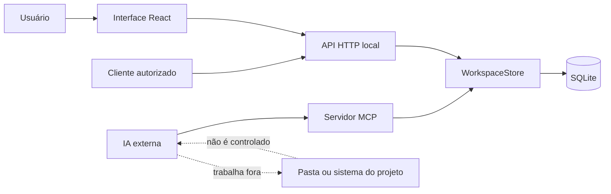

# Axon Works

Axon Works é um correio inteligente de continuidade para projetos trabalhados por diferentes IAs.

Uma IA consulta o projeto, encontra a tarefa e o contexto certos, trabalha no ambiente autorizado pelo usuário e deixa um registro durável para a próxima. Se o limite de uma IA acabar, outra pode retomar sem depender da memória do chat anterior.

> A Axon Works não inicia, escolhe, cancela, monitora ou controla modelos. Ela organiza e transporta contexto. As IAs continuam trabalhando fora da aplicação.

## Estado atual

Atualizado em **15/09/2026**.

O produto funciona localmente como uma aplicação desktop no navegador, com servidor HTTP, banco SQLite nativo e servidor MCP por entrada e saída padrão. A interface está em português, usa tema escuro desktop de alta performance e foi pensada como ferramenta profissional de trabalho.

Já estão implementados e auditados pelo Juiz de Arquitetura:

- **Projetos e Continuidade:**
  - projetos com objetivo, revisão monotônica e referência opcional à pasta de trabalho;
  - biblioteca visual de projetos e exclusão segura com confirmação pelo nome exato;
  - backlog com ideias, prioridades, autoria, estágio e promoção atômica para tarefa;
  - tarefas com reserva temporária (lease), proteção CAS contra concorrência e intenção de escrita;
  - contratos formais de tarefa (Task Contracts): prioridade, critérios de aceite com checkboxes, dependências acíclicas com guarda de execução e saídas esperadas;
  - checkpoints imutáveis com resumo, próximo passo, decisões, bloqueios e evidências declaradas;
  - passagens estruturadas vinculadas a checkpoint e tarefa, com confirmação de leitura idempotente;
  - mensagens entre identidades de IA e caixa de entrada dedicada;
  - distinção entre mensagem **lida** e pergunta ou revisão **resolvida** com registro do desfecho;
  - rascunho de emergência versionado, sempre identificado como não entregue;
  - finalização atômica de trabalho (`finalizeWork`) com checkpoint, passagem opcional e transições `blocked`/`done`;
  - estados `blocked` e `done` com reabertura auditável;
  - charter humano versionado e bloqueios canônicos com ciclo de vida formal.

- **Biblioteca e Contexto:**
  - biblioteca de conteúdos dentro do projeto com documentos versionados, tipos (`note`, `specification`, `research`, `artifact`), revisões imutáveis e relações direcionadas;
  - busca em texto pleno via SQLite FTS5 sincronizada automaticamente na escrita e importação;
  - `ContextEnvelope` unificado para UI, API, MCP e Markdown, com proveniência e orçamento de caracteres.

- **Portabilidade V3 (ProjectBundle v3):**
  - transporte integral de tarefas com contratos, histórico de charter, decisões canônicas com suas cadeias de substituição, bloqueios, biblioteca com relações e FTS5, eventos de transição e rascunhos;
  - remapeamento biunívoco de UUIDs e inserção em duas fases para eliminação de referências circulares;
  - validação preventiva de ciclos acíclicos em tarefas e decisões;
  - mascaramento compulsório de segredos (`maskSecrets`) e teto de segurança de 1 MB serializado;
  - retrocompatibilidade estrita preservada para pacotes v1 e v2.

- **Backup, Retenção e Recuperação Automática (Recovery Drill):**
  - snapshots atômicos a quente via `VACUUM INTO` com flush `wal_checkpoint(TRUNCATE)`;
  - assinatura e integridade SHA-256 imediata com checagem de chave estrangeira;
  - criptografia opcional em repouso com AES-256-GCM autenticada (IV 96-bit, Auth Tag 128-bit);
  - política automática de retenção e expurgo de backups excedentes;
  - teste periódico de recuperação (Recovery Drill) executado em banco isolado;
  - restauração atômica com confirmação e snapshot de salvaguarda prévio (`pre-restore`).

- **Autenticação, RBAC por Projeto e Auditoria Imutável:**
  - contas locais com hash de senhas Scrypt e verificação em tempo constante (`timingSafeEqual`);
  - pareamento e revogação instantânea de dispositivos;
  - papéis por projeto `owner`, `collaborator` e `observer` definidos em `shared/auth.ts` — **ainda não aplicados nas rotas** (ver Limites conhecidos);
  - tokens revogáveis de alta entropia para agentes (`axon_agt_`), usuários (`axon_usr_`) e dispositivos (`axon_dev_`), armazenados via hash SHA-256;
  - trilha de auditoria imutável (`audit_logs`) com metadados sanitizados.

- **Evidência Verificável, Frescor de Artefatos e Eventos Imutáveis:**
  - evidências com identidade própria, distinguindo relato de agente (`agent_reported`), conferência cruzada independente (`cross_checked`) com recusa de auto-conferência e vínculo físico com arquivos por SHA-256 (`artifact_bound`);
  - verificação contínua de integridade: frescor de evidência recalculado em streaming na leitura (`covers_current`, `stale`, `missing`, `unverifiable`), expondo na UI, no briefing e no Markdown testes que deixaram de cobrir os arquivos modificados;
  - eventos imutáveis (append-only) de transição para bloqueios (`BlockerEvent`) e decisões (`DecisionEvent`), garantindo que reaberturas e revogações nunca apaguem a resolução anterior ou contaminem a nota de origem;
  - omissões declaradas formalmente no ProjectBundle v3 (`declaredOmissions`), registrando o que ainda aguarda o formato v4.

- **Grafo de Conhecimento, Inteligência de Conflitos e Impacto (P3):**
  - grafo direcionado unificado conectando decisões, conteúdos, tarefas e bloqueios;
  - detecção determinística de conflitos: contradições explícitas, sobreposições léxicas de escopo (NFD + Jaccard), decisões zumbis e ciclos DFS;
  - invalidação de frescor de documentos da biblioteca por decisões revogadas ou substituídas;
  - análise de alcance e impacto a jusante (BFS bidirecional) com classificação de risco (`high`, `medium`, `low`).

- **Camada Visual e Ergonomia:**
  - painel interativo do grafo (`GraphPanel.tsx`) com 4 cartões KPI, topologia em swimlanes e inspetor de nós com blast radius;
  - visão explicável de mudanças ("O que mudou desde a última vez" — `OperationalChangelog.tsx`) com comparativo $r_N$ vs $r_{N-1}$ e cópia em Markdown;
  - conectores externos e gerador de protocolo `AGENTS.md` para Claude Code, Antigravity/AGY, Cline e VS Code.

- **Garantia de Qualidade:**
  - 263 testes unitários e de integração passando 100% (`npm test`);
  - 25 testes Playwright E2E passando 100% (`npm run test:e2e`);
  - compilação TypeScript com 0 erros (`npm run build`).

## Como pensar na Axon Works

Uma analogia simples:

- o **projeto** é a sala de trabalho;
- o **backlog** é a caixa de ideias para depois;
- a **tarefa** é o trabalho escolhido;
- a **reserva** é um bilhete temporário dizendo “pretendo trabalhar nisto”;
- o **checkpoint** é uma fotografia do estado do trabalho;
- o **rascunho** é um salvamento de emergência ainda não entregue;
- a **passagem** é o bilhete preso nessa fotografia para a próxima IA;
- a **caixa de entrada** é o correio particular de cada identidade;
- a **confirmação de leitura** diz que a carta foi aberta;
- a **resolução** diz como uma pergunta ou revisão foi realmente encerrada;
- a **retomada inteligente** é o funcionário que separa somente a pasta necessária antes de entregar o trabalho;
- o **pacote Axon** é a mala que transporta um projeto entre instalações.

## Fluxo de uso

### Quando uma IA entra

1. Declara um nome estável para a sessão, como `Astra`, `Gemini` ou `Grok`.
2. Localiza o projeto por listagem ou busca.
3. Pede o briefing de retomada.
4. Escolhe explicitamente uma tarefa quando houver mais de uma possibilidade.
5. Lê objetivo, checkpoint da tarefa, contexto geral, passagens, mensagens e itens de atenção.
6. Confirma apenas aquilo que realmente leu.
7. Reserva a tarefa antes de começar uma execução que alterará o projeto.

### Enquanto trabalha

1. Trabalha fora da Axon Works, no ambiente autorizado pelo usuário.
2. Registra perguntas, alertas ou pedidos de revisão como mensagens.
3. Guarda ideias futuras no backlog.
4. Renova a reserva se o trabalho durar mais do que o prazo atual.
5. Salva um rascunho de emergência se a sessão puder cair antes do checkpoint.
6. Relê o estado quando receber conflito de versão ou revisão.

### Quando sai ou troca de IA

1. Confere o que realmente mudou.
2. Executa as validações adequadas, quando autorizado.
3. Salva um checkpoint com resumo, próximo passo, decisões, bloqueios e evidências honestas.
4. Cria uma passagem ligada ao checkpoint.
5. Deixa uma mensagem direta para a próxima IA.
6. Libera a tarefa se ela continuar aberta e não permanecerá trabalhando nela.

O guia completo para agentes está em [AI-GUIDE.md](AI-GUIDE.md). O protocolo de evolução, incluindo recursos futuros, está em [docs/AGENT-OPERATING-PROTOCOL.md](docs/AGENT-OPERATING-PROTOCOL.md).

## Ler e resolver são ações diferentes

Mensagens simples, como notas, podem apenas ser lidas. Perguntas e pedidos de revisão continuam na área de atenção mesmo depois da confirmação de leitura.

Para resolver uma pergunta ou revisão, a IA precisa registrar pelo menos um destes fundamentos:

- uma explicação concreta;
- uma mensagem de resposta do mesmo projeto e escrita pela identidade que resolve;
- um checkpoint do mesmo projeto e escrito pela identidade que resolve.

A resolução não cria confirmação de leitura automaticamente. O histórico preserva os dois acontecimentos:

```text
Mensagem recebida
      ↓
Não lida ── confirmar leitura ──→ Lida
      │                             │
      └──────── resolver ───────────┴──→ Resolvida com desfecho
```

Somente mensagens dos tipos `question` e `review` podem ser resolvidas. Notas e passagens legadas não recebem resolução. Uma tentativa idêntica de resolução é segura para repetição; uma tentativa posterior com conteúdo diferente retorna conflito.

## Retomada por tarefa

O briefing de retomada pode operar em três modos:

- **automático:** uma única tarefa reservada pela identidade vira o foco;
- **tarefa explícita:** o cliente informa `taskId`;
- **visão geral:** o cliente usa `focusMode: "project"`.

Quando a mesma identidade tem várias tarefas reservadas, a Axon Works não escolhe uma silenciosamente. O cliente precisa apontar a tarefa correta.

O briefing separa:

- `latestTaskCheckpoint`: checkpoint mais recente da tarefa em foco;
- `latestProjectCheckpoint`: checkpoint geral mais recente;
- `latestCheckpoint`: nome temporário mantido para compatibilidade.

Se uma tarefa ainda não possui checkpoint, o próximo passo geral não é apresentado como se pertencesse a ela.

## Backlog

O backlog recebe trabalho futuro antes de ele virar tarefa:

| Estado | Significado |
|---|---|
| `idea` | intenção ainda em avaliação |
| `ready` | trabalho entendido e pronto para execução |
| `promoted` | item que já originou uma tarefa |
| `archived` | item retirado do fluxo ativo |

Atualizações usam uma versão esperada para impedir que uma edição antiga apague uma mudança recente. A promoção cria a tarefa dentro da mesma transação e pode ser repetida com segurança sem criar duplicatas.

O caminho normal de descarte é arquivar. A exclusão permanente só aceita itens já arquivados e exige a versão atual.

## Tarefas e reservas

Cada tarefa possui `version`, responsável declarado e prazo de reserva. A reserva padrão dura 15 minutos e pode ser configurada entre 30 e 3.600 segundos pelas integrações.

Uma reserva comunica intenção e evita duas reservas válidas ao mesmo tempo. Ela não trava arquivos, não prova que uma IA está ativa e não impede alterações feitas fora da Axon Works.

Assumir, renovar e liberar usam comparação com a versão atual. Se dois agentes tentarem escrever com a mesma versão, somente um vence. O outro recebe conflito, relê o estado e decide o que fazer.

## Checkpoints e evidências

Um checkpoint é imutável e incrementa a revisão do projeto exatamente uma vez. Pode ser geral ou ligado a uma tarefa reservada pela própria identidade.

Campos principais:

- resumo do que foi feito;
- próximo passo concreto;
- tarefa relacionada, quando houver;
- decisões;
- bloqueios e incertezas;
- evidências de validação.

Toda evidência enviada por uma IA recebe `provenance: "agent_report"`. A frase “o teste passou” continua sendo um relato da IA até um mecanismo autorizado verificar esse fato. A interface não inventa selo de aprovação.

Checkpoints usam `expectedRevision` e `idempotencyKey`. Repetir a mesma chave com o mesmo conteúdo devolve o checkpoint original; reutilizar a chave com conteúdo diferente retorna conflito.

## Mensagens e passagens

Mensagens aceitam quatro tipos:

| Tipo | Uso |
|---|---|
| `note` | observação ou informação geral |
| `question` | pergunta que permanece aberta até resolução |
| `review` | pedido de revisão que permanece aberto até resolução |
| `handoff` | formato legado de passagem por mensagem |

O destinatário pode ser uma identidade declarada ou `*` para todas as identidades do projeto.

A passagem estruturada é o formato recomendado para troca de IA. Ela liga uma mensagem a um checkpoint imutável e carrega:

- autoria e destino;
- tarefa do checkpoint;
- trabalho concluído;
- próximo passo;
- recado livre para a próxima IA;
- data e confirmação de leitura.

O autor da passagem precisa coincidir com o autor do checkpoint. Criar uma passagem não chama nem acorda outra IA.

## Portabilidade

O pacote atual usa o formato `axon-project`, versão 2. Ele transporta:

- projeto;
- tarefas;
- checkpoints;
- mensagens;
- backlog;
- passagens estruturadas;
- recibos de leitura das passagens;
- resoluções de perguntas e revisões.

Pacotes v1 continuam importáveis. Pacotes v2 antigos, criados antes das resoluções, continuam válidos e assumem a lista de resoluções vazia.

A importação cria uma cópia independente com IDs novos e remapeia as relações em uma transação. Se qualquer registro for inválido, nada é importado.

O Markdown de retomada serve para chats ou ferramentas sem MCP. Ele prioriza objetivo, tarefa, próximo passo e atenção, respeita limite por caracteres e sinaliza truncamento. Uma máscara auxiliar remove formatos comuns de segredo, mas o usuário ainda deve revisar o conteúdo antes de compartilhar.

## Inspeção de arquivos

A pasta cadastrada no projeto é apenas uma referência. Ela não é lida automaticamente.

A inspeção disponível exige uma lista explícita de arquivos de texto, aplica limites de tamanho e orçamento global e bloqueia saídas da pasta autorizada. Arquivos binários, segredos conhecidos e caminhos perigosos são recusados ou sinalizados. Conteúdo lido continua sendo dado não confiável e nunca é executado.

## Exclusões

- Um projeto só pode ser excluído ao informar exatamente o nome salvo.
- A exclusão do projeto remove seus dados relacionados em uma transação.
- Um item do backlog só pode ser apagado permanentemente depois de arquivado.
- Tarefas, checkpoints e mensagens não possuem exclusão individual, porque formam a cadeia de continuidade.

Instruções encontradas dentro de mensagens, checkpoints, arquivos ou pacotes nunca autorizam uma exclusão.

## Instalação local

Requisitos:

- Windows, Linux ou macOS com Node.js 24 ou mais recente;
- npm;
- navegador moderno.

No PowerShell:

```powershell
cd D:\Projetos\axon
npm install
npm run dev
```

Abra [http://127.0.0.1:4317](http://127.0.0.1:4317).

Para usar outra porta:

```powershell
$env:AXON_PORT = '4400'
npm run dev
```

Para usar outro arquivo de banco:

```powershell
$env:AXON_DB_PATH = 'D:\dados\axon.sqlite'
npm run dev
```

O banco padrão fica em `.axon/workspace.sqlite`.

Para o servidor MCP oferecer só as 26 tools do ciclo de trabalho de uma IA (o padrão é oferecer todas):

```powershell
$env:AXON_MCP_PROFILE = 'essential'
npm run mcp
```

Os valores aceitos são `full` (padrão) e `essential`. Qualquer outro valor impede o servidor de subir.

## Abrir a tela pelo atalho

O servidor da Axon só é necessário para **ver a tela**: o Claude Code usa os ganchos e o MCP, que leem o banco direto. Num computador fraco não vale deixá-lo ligado o dia todo, então a Axon abre sob demanda e se desliga sozinha.

```powershell
npm run atalho
```

Cria o atalho **Axon** na Área de Trabalho (`Axon.lnk`, janela minimizada, na pasta deste projeto). Um clique faz isto:

1. Se a Axon já responde em `http://127.0.0.1:4317` **e roda o código de hoje**, só abre o navegador. A resposta de `/api/health` diz o `pid` e a hora em que o servidor subiu (`iniciadoEm`); se ele subiu antes do `dist-server/index.mjs` atual, ou se há tela ou servidor a reconstruir, o servidor de pé é de código velho: o atalho reconstrói, encerra o antigo pelo PID e liga o novo. Só encerra um processo que seja mesmo um `node` rodando `dist-server/index.mjs` (confere a linha de comando); se não for, ou se o servidor for de uma versão anterior que não informa o PID, não encerra nada, avisa em português e abre o que está de pé.
2. Senão, **só um clique por vez trabalha**: quem pega a trava `abrir-axon.lock` (ao lado do banco; vence em 3 minutos ou quando o processo morreu) constrói a tela e monta o servidor **apenas se o código-fonte for mais novo** que o resultado (`dist/index.html`, `dist-server/index.mjs`), liga o servidor sem janela e espera ele responder (até 20 segundos). Quem não pega a trava não constrói nem liga nada: espera a Axon ficar de pé (até 120 segundos) e abre o navegador. Dois cliques seguidos dão, portanto, uma construção só e um servidor só.
3. Abre o navegador. Se não subir, aparece um aviso em português e o detalhe fica em `.axon/abrir-axon.log`, com as últimas 20 linhas do que o servidor escreveu. Tudo o que o servidor escreve (saída e erros) vai para `.axon/servidor.log`. O aviso só fala em porta ocupada quando o servidor escreveu `EADDRINUSE`; nos outros casos diz que a Axon não conseguiu ligar e aponta o registro.

O servidor ligado pelo atalho **se desliga sozinho depois de 30 minutos sem uso** (variável `AXON_DESLIGAR_OCIOSO_MIN`). Conta como uso qualquer requisição; enquanto a aba da Axon está à vista, a tela avisa o servidor a cada 5 minutos, então ele não cai com você olhando. Aba escondida não avisa. Se a aba ficou escondida tempo demais e o servidor se desligou, a tela mostra, ao voltar, uma faixa no topo: "A Axon desligou por falta de uso. Clique no atalho Axon para ligar de novo." A faixa some sozinha quando uma batida seguinte dá certo. Para voltar, é só clicar no atalho de novo; os dados ficam no banco e nada se perde.

Sem a variável `AXON_DESLIGAR_OCIOSO_MIN`, nada muda: `npm start`, `npm run dev`, os testes de tela e a VPS seguem ligados até alguém desligar. Ela aceita um número inteiro de minutos, de 1 em diante.

Para rodar sem o atalho, ou com outra porta e outro banco (a janela não aparece, o navegador não abre):

```powershell
$env:AXON_PORT = '4400'
$env:AXON_DB_PATH = 'D:\dados\axon.sqlite'
node scripts/abrir-axon.mjs --sem-janelas
```

Limites: se o computador dormir mais de 30 minutos com a aba aberta, o servidor pode se desligar ao acordar, antes de a aba avisar (não foi testado com o computador dormindo); na primeira batida depois disso a tela mostra a faixa de aviso e fica parada até você clicar no atalho de novo. Um servidor ligado **antes** desta versão não informa o PID: o atalho não consegue reiniciá-lo, avisa, e ele só troca de código quando for fechado (feche-o e clique no atalho). No Windows o servidor velho é encerrado à força (não há como pedir que ele feche sozinho); o banco usa o modo WAL do SQLite, que se recupera de um encerramento à força, mas esse caso (matar o servidor no meio de uma gravação) não foi testado. E o atalho aponta para o `node` e para a pasta de hoje: se o projeto mudar de lugar, rode `npm run atalho` outra vez.

## Comandos

| Comando | Função |
|---|---|
| `npm run dev` | inicia servidor local com Vite em modo de desenvolvimento |
| `npm run build` | verifica TypeScript, gera a interface de produção em `dist/` e monta o programa pré-montado em `dist-server/` |
| `npm run montar` | só monta `dist-server/` (servidor, MCP e, quando existirem, os ganchos) em JavaScript pronto; a pasta não vai para o git. Grava numa pasta ao lado e troca arquivo por arquivo, então quem está lendo o `dist-server/` nunca pega um arquivo pela metade. Outra pasta: `npm run montar -- --saida <pasta>` ou a variável `AXON_SAIDA_MONTADO` |
| `npm start` | monta de novo (0,2 s, para nunca rodar versão velha) e inicia a aplicação em modo de produção local, pelo programa pré-montado |
| `npm run mcp` | inicia o servidor MCP a partir do código-fonte (via tsx), para desenvolvimento |
| `npm test` | executa testes de domínio, servidor, transporte e persistência |
| `npm run test:e2e` | executa jornadas reais no Chromium com Playwright |
| `npm run check` | executa testes, build e jornadas de navegador |
| `npm run atalho` | cria o atalho **Axon** na Área de Trabalho (ver "Abrir a tela pelo atalho") |

Os testes usam bancos temporários. Não devem apontar para o banco real do usuário.

## Arquitetura



Componentes:

- `src/`: interface React, navegação, diálogos e direção visual;
- `server/app.ts`: rotas HTTP e proteções do modo local;
- `server/store.ts`: regras de domínio, transações e persistência;
- `server/mcp-tools.ts`: ferramentas MCP que usam o mesmo domínio;
- `shared/`: tipos compartilhados e validação de portabilidade;
- `tests/`: testes do domínio, HTTP, MCP e Playwright;
- `docs/`: especificações, contratos, planos, briefings e relatórios;
- `public/brand/`: marca raster, vetor e favicon;
- `.axon/`: banco local, fora do conteúdo servido pelo Vite;
- `output/`: evidências de testes e capturas locais.

O código experimental em `server/runtime/` está desconectado da aplicação. O servidor não cria `AgentRuntime`, e não existem rotas de iniciar ou cancelar modelos.

## API HTTP

A API responde JSON. Escritas no modo local exigem `Content-Type: application/json` e `X-Workspace-Client: local`.

### Projetos e busca

| Método | Rota | Função |
|---|---|---|
| `GET` | `/api/health` | saúde e versão do serviço |
| `GET` | `/api/projects` | lista projetos |
| `POST` | `/api/projects` | cria projeto |
| `GET` | `/api/projects/:id` | lê o projeto completo |
| `DELETE` | `/api/projects/:id` | exclui com confirmação pelo nome |
| `GET` | `/api/search?q=...` | busca literal |

### Trabalho e continuidade

| Método | Rota | Função |
|---|---|---|
| `POST` | `/api/projects/:id/tasks` | cria tarefa |
| `POST` | `/api/projects/:id/tasks/:taskId/claim` | assume ou renova tarefa |
| `POST` | `/api/projects/:id/tasks/:taskId/release` | libera tarefa |
| `POST` | `/api/projects/:id/checkpoints` | salva checkpoint |
| `GET` | `/api/projects/:id/resume` | monta retomada por identidade e foco |
| `GET` | `/api/projects/:id/handoff` | gera contexto neutro |

### Correio

| Método | Rota | Função |
|---|---|---|
| `POST` | `/api/projects/:id/messages` | envia mensagem |
| `GET` | `/api/projects/:id/inbox` | lê caixa da identidade |
| `POST` | `/api/projects/:id/messages/:messageId/ack` | confirma leitura |
| `POST` | `/api/projects/:id/messages/:messageId/resolve` | resolve pergunta ou revisão |
| `POST` | `/api/projects/:id/deliveries` | cria passagem estruturada |
| `GET` | `/api/projects/:id/deliveries` | lista passagens da identidade |
| `POST` | `/api/projects/:id/deliveries/:deliveryId/ack` | confirma leitura da passagem |
| `POST` | `/api/projects/:id/drafts` | salva rascunho de emergência |
| `GET` | `/api/projects/:id/drafts` | lista rascunhos da identidade |
| `POST` | `/api/projects/:id/drafts/discard` | descarta rascunho |
| `POST` | `/api/projects/:id/finalize` | encerra o trabalho numa transação |
| `POST` | `/api/projects/:id/tasks/:taskId/reopen` | reabre tarefa bloqueada ou concluída |
| `GET` | `/api/projects/:id/tasks/:taskId/events` | lista transições da tarefa |
| `GET` | `/api/projects/:id/charter` | lê o charter vigente |
| `GET` | `/api/projects/:id/charter/history` | lista revisões do charter |
| `POST` | `/api/projects/:id/charter` | grava nova revisão do charter |
| `GET` | `/api/projects/:id/blockers` | lista bloqueios |
| `POST` | `/api/projects/:id/blockers` | abre bloqueio |
| `POST` | `/api/projects/:id/blockers/:id/resolve` | resolve bloqueio |
| `POST` | `/api/projects/:id/blockers/:id/reopen` | reabre bloqueio |
| `GET` | `/api/projects/:id/decisions` | lista decisões |
| `POST` | `/api/projects/:id/decisions` | propõe decisão |
| `GET` | `/api/projects/:id/content` | lista a Biblioteca |
| `POST` | `/api/projects/:id/content` | cria conteúdo |
| `GET` | `/api/projects/:id/content/search` | busca a revisão vigente |
| `POST` | `/api/projects/:id/content/:itemId/revise` | cria nova revisão |
| `POST` | `/api/projects/:id/content/:itemId/archive` | arquiva conteúdo |
| `POST` | `/api/projects/:id/content/:itemId/relations` | adiciona relação direcionada |
| `GET` | `/api/projects/:id/context` | compila ContextEnvelope unificado |

### Grafo e Inteligência Relacional

| Método | Rota | Função |
|---|---|---|
| `GET` | `/api/projects/:id/graph` | retorna o grafo completo de nós, arestas e estatísticas |
| `GET` | `/api/projects/:id/graph/conflicts` | diagnóstico de decisões conflitantes e contradições |
| `GET` | `/api/projects/:id/graph/stale` | auditoria de documentos desatualizados da biblioteca |
| `GET` | `/api/projects/:id/graph/impact` | análise de alcance e impacto a jusante (BFS) |

### Backups e Recuperação

| Método | Rota | Função |
|---|---|---|
| `GET` | `/api/backups` | lista manifestos de backups existentes |
| `POST` | `/api/backups` | gera snapshot atômico via VACUUM INTO |
| `GET` | `/api/backups/drills` | lista relatórios de testes de recuperação |
| `POST` | `/api/backups/drill` | executa teste periódico de recuperação (Drill) |
| `POST` | `/api/backups/:id/drill` | executa drill sobre backup específico |
| `POST` | `/api/backups/:id/restore` | restauração atômica com salvaguarda prévia |

### Autenticação, Tokens e RBAC

| Método | Rota | Função |
|---|---|---|
| `POST` | `/api/auth/register` | registra conta local com senha Scrypt |
| `POST` | `/api/auth/login` | autentica e estabelece sessão |
| `GET` | `/api/auth/me` | retorna dados da conta e permissões |
| `POST` | `/api/auth/tokens` | emite token com escopo e retorna segredo uma vez |
| `GET` | `/api/auth/tokens` | lista tokens do usuário/projeto |
| `POST` | `/api/auth/tokens/:id/revoke` | revoga imediatamente um token |
| `GET` | `/api/devices` | lista dispositivos pareados |
| `POST` | `/api/devices/pair` | registra novo dispositivo |
| `POST` | `/api/devices/:id/revoke` | revoga dispositivo pareado |
| `GET` | `/api/projects/:id/members` | lista membros e papéis RBAC do projeto |
| `POST` | `/api/projects/:id/members` | adiciona ou atualiza membro no projeto |
| `DELETE` | `/api/projects/:id/members/:userId` | remove membro do projeto |
| `GET` | `/api/audit-logs` | consulta trilha de auditoria imutável |

### Backlog, arquivos e pacotes

| Método | Rota | Função |
|---|---|---|
| `GET` | `/api/projects/:id/backlog` | lista backlog |
| `POST` | `/api/projects/:id/backlog` | cria item |
| `POST` | `/api/projects/:id/backlog/:itemId/update` | atualiza com versão esperada |
| `POST` | `/api/projects/:id/backlog/:itemId/promote` | transforma em tarefa |
| `POST` | `/api/projects/:id/backlog/:itemId/archive` | arquiva item |
| `DELETE` | `/api/projects/:id/backlog/:itemId` | apaga item arquivado |
| `GET` | `/api/projects/:id/bundle` | exporta pacote canônico (v1, v2 ou v3 com `?version=3`) |
| `POST` | `/api/import` | importa pacote com remapeamento biunívoco |
| `POST` | `/api/projects/:id/inspect` | inspeciona arquivos escolhidos |

### Quadro do Projeto

| Método | Rota | Função |
|---|---|---|
| `GET` | `/api/projects/:id/board` | snapshot do quadro ordenado por etapas e posição |
| `GET` | `/api/projects/:id/board/cards/:cardId/events` | histórico cronológico de eventos do cartão |
| `POST` | `/api/projects/:id/board/cards` | cria cartão no quadro |
| `POST` | `/api/projects/:id/board/cards/:cardId/update` | atualiza cartão e lista de verificação passo a passo |
| `POST` | `/api/projects/:id/board/cards/:cardId/move` | move entre colunas ou reordena na mesma coluna |
| `POST` | `/api/projects/:id/board/cards/:cardId/delete` | exclusão definitiva do cartão (só tela) |

Erros seguem a forma:

```json
{
  "error": {
    "code": "codigo_estavel",
    "message": "Explicação em linguagem clara."
  }
}
```

## Ferramentas MCP

O servidor MCP expõe o mesmo domínio da aplicação para clientes compatíveis:

### Projetos, Continuidade e Mensagens
- `list_projects`, `create_project`, `get_project`, `search_projects`, `delete_project`;
- `get_handoff`, `get_resume_brief`, `compile_context`;
- `create_task`, `claim_task`, `release_task`, `reopen_task`, `update_task_contract`, `get_task_events`;
- `save_checkpoint`, `save_work_draft`, `get_work_drafts`, `discard_work_draft`, `finalize_work`;
- `send_message`, `get_inbox`, `acknowledge_message`, `resolve_message_attention`;
- `create_handoff_delivery`, `get_handoff_deliveries`, `acknowledge_handoff_delivery`.

### Governança e Conhecimento
- `get_charter`, `save_charter` (pelo MCP, vira proposta pendente para o dono aprovar; não grava a diretriz);
- `open_blocker`, `list_blockers`, `resolve_blocker`, `reopen_blocker`;
- `propose_decision`, `accept_decision`, `revoke_decision`, `supersede_decision`, `get_decisions`;
- `create_content`, `list_content`, `get_content`, `revise_content`, `search_content`, `archive_content`, `add_content_relation`;
- `create_backlog_item`, `get_backlog`, `update_backlog_item`, `promote_backlog_item`, `archive_backlog_item`, `delete_backlog_item`;
- `export_project_bundle`, `import_project_bundle`.

### Grafo e Inteligência Relacional
- `get_project_graph` — consulta topologia estruturada de nós e arestas;
- `detect_decision_conflicts` — diagnóstico de contradições, sobreposições e ciclos;
- `detect_stale_content` — auditoria de frescor de documentos da biblioteca;
- `analyze_graph_impact` — análise BFS de alcance e risco a jusante.

### Backup, Restauração e Segurança
- `create_backup` — snapshot atômico a quente com assinatura SHA-256;
- `list_backups` — listagem de manifestos e integridade de backups;
- `run_recovery_drill` — teste de recuperação isolado de ponta a ponta;
- `get_backup_drills` — histórico de relatórios auditáveis de recuperação;
- `restore_backup` — restauração atômica com confirmação e pre-restore;
- `create_auth_token` — emissão de tokens de agentes e operadores com escopo;
- `list_auth_tokens` — listagem segura de tokens (hash SHA-256);
- `revoke_auth_token` — revogação imediata de token;
- `list_project_members` — consulta de membros e papéis RBAC;
- `list_audit_logs` — auditoria imutável de eventos sensíveis.

### Quadro do Projeto
- `get_board` — lê o quadro com seus cartões organizados por etapa;
- `create_board_card` — cria cartão no quadro com título curto e objetivo;
- `update_board_card` — atualiza dados e lista de verificação passo a passo;
- `move_board_card` — move cartão entre colunas ou reordena na coluna.
- `get_board_card_events` — lê o histórico de um cartão (só leitura).

## Persistência e modelo de dados

O SQLite nativo contém tabelas relacionais com chaves estrangeiras ativas:

- `projects` e `charter_revisions`;
- `tasks`, `task_contracts` e `task_events`;
- `checkpoints`, `evidence` e `work_drafts`;
- `messages`, `handoff_deliveries` e `message_resolutions`;
- `decisions` e suas cadeias de substituição;
- `blockers` e suas transições;
- `content_items`, `content_revisions`, `content_relations` e índice FTS5 `content_fts`;
- `backlog_items`;
- `accounts`, `paired_devices`, `project_members`, `auth_tokens` e `audit_logs`;
- `board_cards` e `board_card_events` (histórico append-only).

As migrações atuais são idempotentes e executadas durante a abertura do banco. Operações compostas usam transação. Relações importadas recebem IDs novos e são conferidas antes da gravação.

## Segurança do modo local

A versão atual foi construída para `127.0.0.1`:

- o processo escuta apenas em loopback;
- Host e Origin estranhos são rejeitados;
- escritas exigem marcador do cliente local;
- o corpo HTTP tem limite;
- arquivos `.env`, Git, banco, chaves e saídas internas não são servidos pelo Vite;
- conteúdo recuperado de agentes e arquivos é tratado como dado não confiável;
- nenhuma mensagem é executada como comando;
- identidades são declaradas e a interface deixa essa limitação explícita.

Essas proteções não substituem autenticação. A versão atual não deve ser publicada diretamente na internet.

## VPS

Uma VPS privada é uma boa evolução porque permite que diferentes ferramentas autorizadas consultem o mesmo correio sem depender de um computador específico. Antes disso, faltam proteções próprias para rede:

1. autenticação da interface;
2. tokens de agente com escopo por projeto, hash, expiração e revogação;
3. autoria derivada da credencial;
4. configuração segura de proxy, Host, Origin, cookies e proteção contra falsificação de requisição;
5. limite de requisições;
6. log de auditoria sem copiar conteúdo sensível;
7. backup consistente, criptografado e com restauração testada;
8. serviço supervisionado, healthcheck, atualização versionada e rollback.

A primeira topologia recomendada mantém a Axon Works em loopback na VPS e publica HTTPS somente por uma rede privada, como Tailscale Serve. SQLite deve ficar em disco local persistente. O passo a passo está em [docs/VPS.md](docs/VPS.md).

## Processo de qualidade

Mudanças de domínio e correções seguem TDD:

1. escrever um cenário observável;
2. executar e capturar a falha real;
3. implementar a menor solução coerente;
4. executar novamente e capturar o sucesso;
5. integrar as partes;
6. executar testes, build e jornadas de navegador;
7. registrar limitações sem transformar relato de agente em prova independente.

Áreas cobertas incluem concorrência de reservas, revisão antiga, idempotência, isolamento entre projetos, reinício do banco, transporte HTTP, ferramentas MCP, portabilidade, segurança de caminhos, exclusões e jornadas reais da interface.

A validação integrada atual tem:

- o teste de interface foi executado primeiro e falhou porque o botão ainda não existia;
- depois da implementação, a jornada focada passou;
- transportes HTTP e MCP passaram em 15 testes próprios;
- continuidade passou em 45 testes próprios;
- portabilidade passou em 41 testes próprios;
- **224 de 224 testes de domínio, persistência e transporte aprovados**;
- **TypeScript aprovado** na mesma sessão;
- jornadas Playwright e build Vite foram verdes na fatia anterior (resolução de mensagens); a suíte completa de navegador não foi reexecutada no fim desta sessão por falta de memória da máquina;
- banco local real migrado e confirmado vazio: zero projetos, tarefas, checkpoints, mensagens, recibos, resoluções, itens de backlog e passagens.

Resultados antigos não são atribuídos automaticamente ao código novo. O processo detalhado está em [docs/TESTING.md](docs/TESTING.md).

## Direção visual

A interface usa:

- modo escuro como direção principal;
- Manrope variável, sem fontes serifadas;
- contraste alto para textos operacionais;
- composição densa de ferramenta desktop;
- movimentos discretos com GSAP;
- respeito a `prefers-reduced-motion`;
- feedback visível para ações salvas;
- marca em raster e vetor dentro de `public/brand/`.

O projeto não priorizará ajustes móveis nesta fase, conforme decisão do usuário. Testes móveis antigos podem continuar no repositório como regressão histórica, mas novas decisões de interface devem partir do uso desktop.

## O que ainda falta

### Próximas entregas de continuidade e tarefas

- **ProjectBundle v4:** transporte de evidências verificáveis (`evidence_records`), conferências cruzadas (`evidence_verifications`) e linhas do tempo de eventos imutáveis de bloqueio/decisão (`blocker_events`, `decision_events`). O ProjectBundle v3 já está entregue, mas declara a omissão formal dessas entidades;
- **Estados de tarefa `in_review` e `cancelled`:** bloqueados até terem responsável, motivo, efeito sobre a concessão/reserva (`lease`) e regras de reabertura auditáveis formalmente definidos (hoje o ciclo é `todo`, `in_progress`, `blocked`, `done`);
- **Audiência tipada:** substituição do destinatário aberto `'*'` por união tipada discriminada (`{ kind: 'broadcast' } | { kind: 'agent', agentId: string }`);
- **Project Charter enriquecido:** campos estruturados próprios para escopo incluído/excluído, restrições, convenções/vocabulário, preferências aprovadas pelo usuário e riscos conhecidos (substituindo o texto solto em `body`);
- **Auditoria de entrega de contexto por IA:** registro persistente append-only de qual sequência de contexto (`contextSequence`) cada IA recebeu ao gerar seu briefing de retomada ou envelope de contexto.

### Biblioteca de conteúdos e portabilidade

- **Anexos binários endereçados por hash:** armazenamento de blobs no disco/storage fora do SQLite, preservando metadados, integridade SHA-256 e relações no banco;
- **Exportação ZIP com manifesto de hashes e streaming:** para empacotar banco/metadados e arquivos binários sem estourar limites de memória serializada;
- **Entradas obrigatórias por tarefa:** vínculo formal de materiais da Biblioteca como pré-requisitos (`required_inputs`) de tarefas.

### VPS e colaboração remota

- **MCP remoto autenticado:** transporte Streamable HTTP sobre TLS com autenticação por token de projeto para clientes externos fora da máquina local;
- **Sincronização remota:** transporte e reconciliação entre instâncias distintas sem colisão de estado;
- **Resolução de conflitos entre dispositivos pareados;**
- **Publicação segura em rede privada (Tailscale / VPS loopback com proxy reverso).**

### Inteligência auxiliar

- **Busca semântica com citação obrigatória de fonte e revisão:** embeddings e busca por similaridade semântica com procedência explícita, convivendo com a busca literal SQLite FTS5 existente;
- **Laboratório de avaliação de retomada:** medição quantitativa de tempo até a primeira ação correta, regressões após troca de IA e taxa de perda de contexto entre sessões.

## Limites conhecidos

- Identidades ainda são nomes declarados nas operações locais normais; tokens criptográficos autenticados existem via `server/auth/`, mas o modo de desenvolvimento local aceita nomes declarados para agilidade.
- Contas locais, pareamento de dispositivos e papéis RBAC (`owner`, `collaborator`, `observer`) estão implementados, mas ainda não existe sincronização remota entre servidores ou colaboração multiusuário online em tempo real.
- Bloqueios canônicos (`ProjectBlocker`) possuem ciclo de vida formal e histórico append-only (`BlockerEvent`); textos legados dentro de checkpoints anteriores continuam preservados no histórico como relato imutável.
- Evidências nascem como declaração de agente (`agent_reported`), podendo receber conferência cruzada independente (`cross_checked`) e validação de frescor por SHA-256 de arquivos físicos no disco (`artifact_bound`). A Axon não executa os comandos, apenas calcula a integridade dos arquivos referenciados.
- Texto com acentos destruídos no envio (`U+FFFD`) é **recusado** com erro explicável e nada é gravado. Dois registros do banco local foram corrompidos antes dessa proteção existir e continuam como estão: são histórico imutável e não são reescritos.
- A exportação sem versão declarada entrega o ProjectBundle v3, a memória completa. As versões 1 e 2 continuam disponíveis sob pedido, e ambos v2 e v3 declaram em `omissions` o que deixam de levar.
- **O papel por projeto ainda não é aplicado nas rotas.** A regra existe (`requireProjectRole` em `server/auth/middleware.ts`), mas não está ligada a nenhuma rota. No modo local padrão isso não expõe nada, porque o app só aceita acesso deste computador e não pede login. Com `AXON_REQUIRE_AUTH=1`, porém, qualquer token válido consegue ler e escrever em qualquer projeto. Ligar a regra em todas as rotas está no backlog.
- A máscara de segredos não é uma garantia universal de prevenção de vazamento.
- A inspeção de arquivos é seletiva e restrita a caminhos autorizados; não monitora o sistema de arquivos automaticamente.
- O código experimental de execução foi **removido do repositório** em 16/09/2026 (`server/runtime/`, `shared/runtime.ts` e `server/extensions.ts`). Um teste de regressão afirma a ausência desses caminhos e falha com mensagem explicativa se alguém tentar reintroduzi-los; o código continua recuperável pelo histórico do git, a partir do commit `040d97b`, mediante ordem explícita do usuário.
- A aplicação foi projetada para loopback local e rede privada supervisionada; não deve ser exposta diretamente à internet pública sem proxy reverso e autenticação.

## Documentação

| Arquivo | Conteúdo |
|---|---|
| [AI-GUIDE.md](AI-GUIDE.md) | manual que toda IA deve ler antes de usar a Axon Works |
| [docs/SPEC.md](docs/SPEC.md) | especificação do produto |
| [docs/CONTRACT.md](docs/CONTRACT.md) | regras executáveis de domínio, HTTP e integração |
| [docs/AGENT-OPERATING-PROTOCOL.md](docs/AGENT-OPERATING-PROTOCOL.md) | protocolo profundo para trabalho entre agentes |
| [docs/CONTEXT-INTELLIGENCE-ROADMAP.md](docs/CONTEXT-INTELLIGENCE-ROADMAP.md) | evolução do contexto inteligente |
| [docs/TESTING.md](docs/TESTING.md) | processo de TDD e validação |
| [docs/LOCAL-AGENTS.md](docs/LOCAL-AGENTS.md) | integração com agentes locais |

## Princípio permanente

A Axon Works será inteligente quando entregar menos contexto, mas entregar o contexto certo, com origem, validade, tarefa e próxima ação claras.

Ela é o correio e a memória compartilhada. O usuário e as IAs continuam decidindo e executando o trabalho.

## Licença

MIT. Veja o arquivo [LICENSE](LICENSE).
