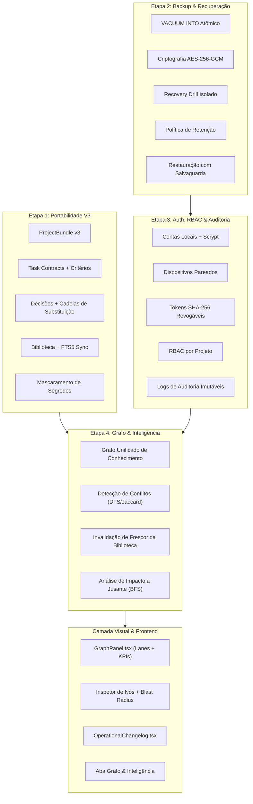

# Axon Works — Documento de Arquitetura Mestra (V3)

**Data:** 15 de Setembro de 2026  
**Status:** Integrado, Auditado e Aprovado pelo Juiz de Arquitetura  
**Versão do Sistema:** 0.1.0 (Macro-Etapas 1, 2, 3 e 4 + Camada Visual e Changelog Operacional)

---

## 1. Visão Geral e Princípios Fundamentais

O **Axon Works** é um correio inteligente e determinístico de continuidade operacional entre agentes autônomos de Inteligência Artificial e operadores humanos. 

### 1.1. Invariante Essencial de Produto
> **O Axon Works NÃO inicia, pausa, cancela, agenda, monitora, orquestra ou executa modelos de linguagem.**

Os agentes trabalham externamente em seus próprios ambientes autorizados pelo usuário (ex: Claude Code, Antigravity/AGY, Cline/VS Code, terminais locais ou instâncias remotas). O Axon Works atua como a **memória canônica, auditável e estruturada** do projeto, garantindo que:
- O contexto seja preservado de forma estritamente transacional entre turnos de IAs.
- Se o limite de contexto ou cota de uma IA se esgotar, a próxima IA assuma o trabalho exatamente onde a anterior parou, sem perda de decisões ou histórico.
- Decisões canônicas, contratos de tarefas, charter humano e materiais da biblioteca não sofram corrupção silenciosa, sobrescrita acidental ou contradições zumbis.

---

## 2. Visão Geral das 4 Macro-Etapas e Camada Visual



---

## 3. Modelo de Dados e Persistência SQLite (`server/store.ts`)

A persistência do Axon Works é baseada no SQLite nativo do Node.js (`node:sqlite DatabaseSync`), configurado com modo **WAL (Write-Ahead Logging)**, verificação compulsória de integridade relacional (`PRAGMA foreign_keys = ON`) e sincronização rigorosa de escrita (`PRAGMA synchronous = NORMAL`).

### 3.1. Tabelas Principais do Esquema Relacional

| Tabela | Responsabilidade | Mecanismo de Integridade |
|---|---|---|
| `projects` | Metadados do projeto, nome, objetivo e revisão monotônica (`revision`). | Incremento atômico por checkpoint. |
| `tasks` | Tarefas de execução com prioridade, responsável, lease e versão (`version`). | Compare-And-Swap (CAS) por versão. |
| `task_contracts` | Critérios de aceite (`acceptance_criteria`), dependências acíclicas e saídas esperadas. | Validação acíclica no store e no bundle. |
| `task_events` | Histórico imutável de transições de status (`todo`, `in_progress`, `blocked`, `done`). | Trilha cronológica de auditoria. |
| `checkpoints` | Fotografias do estado de trabalho com resumo, próximo passo, evidências e autoria. | Imutabilidade e idempotência por hash de payload. |
| `charter_revisions` | Diretriz humana canônica versionada que orienta o objetivo do projeto. | Versionamento monotônico com CAS. |
| `decisions` | Decisões arquiteturais com status (`proposed`, `accepted`, `superseded`, `revoked`). | Linhagem explícita (`supersedes_id` e `superseded_by_id`). |
| `blockers` | Bloqueios e incertezas persistentes (`open`, `mitigated`, `resolved`, `accepted_risk`). | Não somem apenas por leitura; exigem desfecho formal. |
| `content_items` | Entidades da biblioteca de conhecimento com tipo (`note`, `spec`, `research`, `artifact`). | Chave mestra dos documentos. |
| `content_revisions` | Revisões imutáveis do texto de cada documento com autoria e validade declarada. | Histórico completo de versões. |
| `content_relations` | Relações polimórficas direcionadas entre conteúdos, decisões e tarefas. | Tipos `supports`, `contradicts`, `implements`, `references`. |
| `content_fts` | Tabela virtual SQLite FTS5 para indexação léxica da revisão vigente. | Sincronização automática na escrita e importação. |
| `work_drafts` | Rascunhos de emergência salvos por agentes antes de queda de sessão. | Sempre sinalizados como **não entregues**. |
| `handoff_deliveries` | Passagens estruturadas de trabalho endereçadas a identidades específicas ou broadcast. | Recibos de leitura idempotentes. |
| `message_resolutions` | Registro de desfecho para perguntas e revisões. | Distinção entre leitura e resolução. |
| `accounts` | Contas de operadores com senhas Scrypt e papéis globais (`admin`, `user`). | Unicidade de username e Scrypt timing-safe. |
| `paired_devices` | Dispositivos autorizados pelo usuário. | Revogação instantânea em cascata. |
| `project_members` | Associação de usuários a projetos com papéis RBAC (`owner`, `collaborator`, `observer`). | Deleção em cascata na remoção do projeto. |
| `auth_tokens` | Tokens de alta entropia para agentes e usuários (`owner`, `collaborator`, `observer`, `agent`), armazenados via SHA-256. | Segredo bruto nunca armazenado em disco. |
| `audit_logs` | Trilha imutável de ações sensíveis (leituras, escritas, backups, restaurações). | Mascaramento de segredos obrigatório. |

---

## 4. Etapa 1: Portabilidade de Projetos V3 (`shared/portability.ts` e `server/portability/bundle.ts`)

O `ProjectBundle v3` é o padrão canônico para migração e cópia de projetos entre máquinas, ambientes de staging e instâncias de agentes.

### 4.1. Características de Integridade e Segurança
1. **Remapeamento Biunívoco de UUIDs:** Ao importar um pacote, todos os IDs de projetos, tarefas, critérios, revisões, decisões, bloqueios e conteúdos são regenerados, impedindo colisões de chaves primárias e referências cruzadas indesejadas.
2. **Inserção em Duas Fases (Two-Phase Insertion):**
   - **Fase 1:** Todas as decisões são criadas com `supersedesId = null` e `supersededById = null`.
   - **Fase 2:** Uma segunda passagem atômica conecta os ponteiros de substituição remapeados, eliminando deadlocks de chave estrangeira ou falhas de auto-relacionamento.
3. **Detecção Preventiva de Ciclos:**
   - As dependências de tarefas (`assertAcyclicTaskDependencies`) e as cadeias de substituição de decisões (`assertAcyclicDecisionSupersession`) são validadas por algoritmos de busca em profundidade (DFS) com detecção de ciclos antes de qualquer gravação no SQLite.
4. **Sincronização Automática FTS5:** Durante a importação de itens da biblioteca, o índice de texto pleno `content_fts` é imediatamente sincronizado com o texto da revisão vigente importada.
5. **Mascaramento Rigoroso de Segredos (`maskSecrets`):** Chaves de API (`sk-...`, `Bearer ...`, `AIza...`), senhas e tokens são substituídos pelo padrão `[REDACTED]` em todos os campos textuais antes da serialização.
6. **Teto de Segurança:** Limite restrito de 1 MB (`MAX_BUNDLE_SERIALIZED_BYTES = 1024 * 1024`) com parser do Express configurado para 2 MB exclusivamente na rota `/api/import`, prevenindo exaustão de memória ou ataques DoS.
7. **Retrocompatibilidade Estrita:** Pacotes legados v1 e v2 continuam sendo importados sem qualquer perda de dados.

---

## 5. Etapa 2: Motor de Backup e Recuperação Periódica (`server/backup/engine.ts`)

Mecanismo autônomo para cópia de segurança a quente e validação de recuperabilidade sem impacto sobre as conexões ativas.

### 5.1. Fluxo de Snapshot e Criptografia
1. **Snapshot Não Bloqueante em Tempo de Execução:** Utiliza `VACUUM INTO <caminho>` nativo do SQLite após `PRAGMA wal_checkpoint(TRUNCATE)`, garantindo cópia íntegra e atômica, imune a inconsistências de escrita paralela no arquivo WAL.
2. **Checagem Imediata de Baixo Nível:** Validação instantânea do snapshot gerado por meio de `PRAGMA integrity_check` e `PRAGMA foreign_key_check`.
3. **Assinatura Criptográfica:** Cálculo e armazenamento do hash SHA-256 de cada arquivo de backup no seu respectivo manifesto (`backup-<id>.json`).
4. **Cifra Opcional em Repouso com AES-256-GCM:**
   - IV de 96 bits aleatório e Auth Tag de 128 bits.
   - Validação de autenticidade no momento da leitura, impedindo manipulação de dados em repouso.
5. **Política de Retenção de Backups:** Expurgador automático baseado em teto de cópias (`maxCopies`) que remove simultaneamente bancos e manifestos órfãos.

### 5.2. Teste Periódico de Recuperação (Recovery Drill)
Executado em um banco SQLite temporário e estritamente isolado:
- Descriptografa e valida a assinatura SHA-256.
- Executa checagem de baixo nível de integridade física e relacional.
- Instancia um `WorkspaceStore` de teste sobre o arquivo e valida a legibilidade de todos os projetos cadastrados.
- Registra relatório auditável em `DrillReport` (`drill-<id>.json`).

### 5.3. Restauração Atômica com Salvaguarda (Rollback Safe)
A restauração exige confirmação explícita (`confirm: true`):
1. Pré-executa um *Recovery Drill* completo antes de tocar no banco de produção.
2. Cria um snapshot de salvaguarda do banco ao vivo (`pre-restore-<timestamp>.sqlite`).
3. Encerra ordenadamente a conexão ativa (`checkpointAndClose`), remove arquivos temporários WAL e SHM, substitui o arquivo com swap atômico do sistema operacional e reabre a conexão (`reopen`).

---

## 6. Etapa 3: Autenticação, Dispositivos, RBAC e Auditoria (`server/auth/`)

Camada de controle de acesso baseada em princípios de menor privilégio e segurança contra ataques de temporização e vazamento de credenciais.

### 6.1. Componentes Criptográficos
- **Hash de Senhas Scrypt:** Geração de salt aleatório de 16 bytes e 64 bytes derivados (`scrypt:<salt>:<hash>`).
- **Verificação Timing-Safe:** Utilização compulsória de `crypto.timingSafeEqual` para imunidade contra ataques de análise de tempo de resposta.
- **Tokens de Alta Entropia com Prefixos Tipados:**
  - `axon_agt_` para tokens de agentes autônomos.
  - `axon_usr_` para tokens de operadores humanos.
  - `axon_dev_` para dispositivos pareados.
- **Armazenamento Seguro de Tokens (Zero Plaintext):** O token em texto plano é entregue apenas uma única vez na sua criação. O banco SQLite armazena unicamente o hash SHA-256 do segredo.

### 6.2. Hierarquia de Papéis RBAC e Níveis de Autorização
O sistema implementa três vocabulários formais de papéis (`shared/auth.ts` e `server/auth/rbac.ts`):

1. **Papéis Globais de Conta (`AccountRole`):**
   - `admin`: Administrador global da instância; gerencia contas, dispositivos e configurações do sistema.
   - `user`: Usuário padrão do sistema; pode criar projetos e participar de projetos autorizados.

2. **Papéis de Associação a Projeto (`ProjectRole`):**
   - `owner`: Proprietário do projeto. Controle total, exclusão do projeto, gerenciamento de membros e permissões administrativas.
   - `collaborator`: Membro ativo do projeto. Criação e edição de charter, decisões, tarefas, checkpoints, rascunhos, passagens e biblioteca.
   - `observer`: Membro somente-leitura. Inspeção de contexto, histórico, grafo e topologia sem permissão de escrita.

3. **Papéis de Tokens de Autenticação (`TokenRole`):**
   - `owner`: Token com privilégios completos de proprietário.
   - `collaborator`: Token com privilégios de colaborador humano.
   - `observer`: Token somente-leitura.
   - `agent`: Token específico para agentes autônomos com escopo operacional restrito às suas atribuições.

### 6.3. Trilha de Auditoria Imutável
A tabela `audit_logs` registra autor, ação (`auth.login`, `backup.restore`, `token.revoke`, `project.delete`), IP, User-Agent e metadados estruturados sanitizados através de `maskSecrets`.

---

## 7. Etapa 4: Grafo de Conhecimento, Detecção de Conflitos e Invalidação de Frescor (`server/graph/`)

Unifica o entendimento semântico do projeto em um modelo estruturado e direcionado de nós e arestas.

### 7.1. Detecção Algorítmica de Conflitos em Decisões
1. **Contradições Explícitas (`direct_contradiction` — Critical):** Conexão formal de `contradicts` envolvendo decisão aceita e vigente.
2. **Decisões Zumbi (`unresolved_supersession` — Critical):** Decisões antigas cujo status permaneceu incorretamente como `accepted` apesar da existência de substituta aprovada.
3. **Ciclos de Linhagem (`circular_supersession` — Critical):** Detecção de laços circulares na linhagem de decisões via DFS.
4. **Sobreposições Temáticas (`overlapping_accepted_decisions` — Warning):** Normalização NFD sem diacríticos, remoção de stopwords em PT/EN e cálculo do índice de similaridade léxica de Jaccard sobre títulos e corpos de decisões vigentes.

### 7.2. Invalidação de Frescor de Conteúdos da Biblioteca
Identifica especificações e documentos obsoletos:
- `dependency_decision_revoked`: O documento fundamentava-se em decisão que foi revogada.
- `dependency_decision_superseded`: Decisão de apoio foi superada por nova versão.
- `contradicts_accepted_decision`: O documento possui relação declarada de contradição com decisão aceita.
- `referenced_content_archived_or_outdated`: Referencia outro item arquivado ou vencido.
- `declared_needs_review` / `declared_outdated`: Marcação explícita de necessidade de revisão.

### 7.3. Análise de Alcance e Impacto a Jusante (Downstream Reachability)
Busca em largura (BFS) bidirecional que simula o *raio de destruição/impacto (blast radius)* antes que uma decisão seja revogada ou um documento seja alterado:
- Calcula a distância topológica ($d=1, d=2, \dots$).
- Mapeia a rota relacional percorrida (`A -(supports)-> B -(depends_on)-> C`).
- Eleva o nível de risco para `high` na presença de tarefas `in_progress`.

---

## 8. Camada Visual: Painel do Grafo e Linha do Tempo Operacional

### 8.1. Painel Visual do Grafo (`src/GraphPanel.tsx`)
- **4 Cartões de KPI no Topo:** Total de Nós, Relações Ativas, Conflitos de Decisão (críticos/alertas) e Conteúdos Desatualizados.
- **Topologia em Swimlanes (Colunas Semânticas):**
  - *Decisões Canônicas*
  - *Biblioteca & Documentos*
  - *Tarefas & Contratos*
  - *Bloqueios & Incertezas*
- **Inspetor Lateral de Nós com Blast Radius:** Exibe metadados, conexões de entrada/saída, botão de navegação para aba de origem e análise de impacto sob demanda.
- **Subvisões Temáticas:** Alternância fluida entre *Mapa Topológico*, *Inteligência de Conflitos* e *Frescor de Biblioteca*.
- **Filtros e Busca em Tempo Real:** Filtragem instantânea por texto, tipo de entidade e alternador de itens arquivados.

### 8.2. Visão Explicável de Mudanças ("O que mudou desde a última vez" — `src/OperationalChangelog.tsx`)
Renderizada na Visão Geral do projeto, compara a revisão atual ($r_N$) com o ciclo anterior ($r_{N-1}$ ou início do projeto):
- **Tarefas e Entregas:** Tarefas concluídas no ciclo e tarefas com concessão ativa.
- **Diretrizes & Decisões:** Decisões aceitas ou propostas no intervalo.
- **Bloqueios & Passagens:** Bloqueios abertos/resolvidos e passagens trocadas entre agentes.
- **Exportação Rápida:** Botão para cópia instantânea do relatório formatado em Markdown.

---

## 9. Catálogo de Ferramentas MCP e Endpoints REST

### 9.1. Ferramentas MCP Registradas (`server/mcp-tools.ts`)

| Ferramenta | Parâmetros | Descrição |
|---|---|---|
| `get_project_graph` | `projectId`, `nodeTypes?`, `includeArchived?` | Retorna o grafo estruturado de nós, arestas e estatísticas. |
| `detect_decision_conflicts` | `projectId` | Executa diagnóstico de contradições, sobreposições e ciclos de decisões. |
| `detect_stale_content` | `projectId` | Retorna documentos da biblioteca com validade comprometida. |
| `analyze_graph_impact` | `projectId`, `entityType`, `entityId` | Executa BFS topológico calculando raio de impacto e risco. |
| `create_backup` | `note?` | Gera snapshot atômico do banco de dados com assinatura SHA-256. |
| `list_backups` | `limit?` | Lista manifestos de backups existentes com status de integridade. |
| `run_recovery_drill` | `backupId?` | Executa teste de restauração isolado com validação de leitura. |
| `get_backup_drills` | `limit?` | Lista relatórios auditáveis dos últimos recovery drills realizados. |
| `restore_backup` | `backupId`, `confirm` | Restaura snapshot com salvaguarda prévia e verificação estrita. |
| `create_auth_token` | `name`, `subjectType`, `subjectId`, `role`, `projectId?`, `expiresInDays?` | Emite token com escopo e retorna segredo bruto uma única vez. |
| `list_auth_tokens` | `subjectId?`, `projectId?` | Lista tokens cadastrados (exibindo apenas identificador e hash). |
| `revoke_auth_token` | `tokenId` | Revoga imediatamente a autorização de um token. |
| `list_project_members` | `projectId` | Lista membros e papéis RBAC associados a um projeto. |
| `list_audit_logs` | `projectId?`, `action?`, `limit?` | Consulta trilha cronológica imutável de eventos sensíveis. |
| `export_project_bundle` | `projectId`, `version?` | Exporta pacote canônico (v1, v2 ou v3 com suporte completo). |
| `import_project_bundle` | `bundleJson` | Importa pacote com remapeamento biunívoco e validação de ciclos. |

### 9.2. Endpoints HTTP REST (`server/app.ts`)

- `GET /api/projects/:id/graph` — Consulta do grafo completo.
- `GET /api/projects/:id/graph/conflicts` — Relatório de conflitos de decisão.
- `GET /api/projects/:id/graph/stale` — Relatório de frescor de conteúdos.
- `GET /api/projects/:id/graph/impact` — Análise de alcance e impacto a jusante.
- `GET /api/backups` & `POST /api/backups` — Listagem e criação de backups.
- `POST /api/backups/drill` & `POST /api/backups/:id/drill` — Execução de recovery drills.
- `POST /api/backups/:id/restore` — Restauração atômica com confirmação.
- `POST /api/auth/register`, `/api/auth/login`, `GET /api/auth/me` — Gestão de sessão e credenciais.
- `POST /api/auth/tokens` & `POST /api/auth/tokens/:id/revoke` — Gestão de tokens revogáveis.
- `GET /api/projects/:id/members` & `POST /api/projects/:id/members` — Gestão de RBAC por projeto.
- `GET /api/audit-logs` — Consulta de registros de auditoria.
- `GET /api/projects/:id/bundle?version=3` — Exportação de ProjectBundle v3.
- `POST /api/import` — Importação de pacotes (limite de 2 MB).

---

## 10. Matriz de Cobertura de Testes e Garantia de Qualidade

A integridade do Axon Works é garantida por uma suíte de testes 100% automatizada e reprodutível:

```
─────────────────────────────────────────────────────────────────────────────
Suíte de Testes              Testes   Status    Tempo Médio   Cobertura
─────────────────────────────────────────────────────────────────────────────
Testes Unitários & Domínio    263     100% OK   ~18.9s        Store, CAS, Relacionamentos,
(Node test runner + tsx)                                      Backups, RBAC, Criptografia,
                                                              Grafos, BFS, FTS5 e Bundle v3.
─────────────────────────────────────────────────────────────────────────────
Testes E2E com Navegador       25     100% OK   ~2.4m         Jornada Desktop, Mobile 390px,
(Playwright Headless)                                         Checkpoints, Conectores MCP,
                                                              Grafo Visual e Changelog.
─────────────────────────────────────────────────────────────────────────────
Compilação & Tipagem Estrita  -       100% OK   ~354ms        TypeScript tsc --noEmit
(Vite + React 19)                                             Vite Production Bundle
─────────────────────────────────────────────────────────────────────────────
```

---

## 11. Conclusão

Com a conclusão e homologação das 4 macro-etapas e da camada visual, o **Axon Works** consolida-se como uma infraestrutura desktop profissional, segura, imune a perdas de contexto entre IAs e pronta para uso individual ou hospedagem privada supervisionada.
